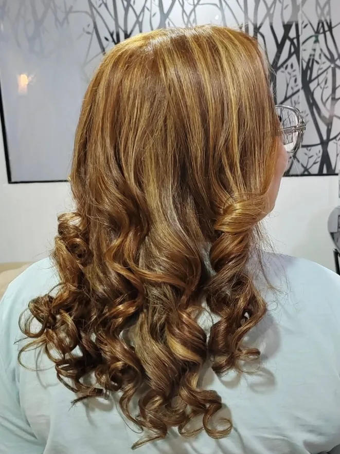

# HANDOFF: Labella Salón + Spa, sitio de varias páginas

Para quien construya `servicios.html`, `galeria.html`, `nosotras.html` y `contacto.html`.
No hace falta haber visto la conversación anterior: todo lo necesario está aquí.

## 1. La idea (no la cambies)

La tarjeta de cita de Labella es el papel del que está hecha cada página. El salón abre a las 6:30
y se inauguró cortando una cinta vino: esa cinta es **la cinta** del sitio (barras vino `#7B2D4E`
sobre papel). Cada sección es otra pieza de la misma papelería: una tarjeta, una hoja con borde
ondulado, un talón perforado. Siempre formas rellenas con bordes reales, nunca cajas con contorno.

Dirección del taste skill: "The page is the object" (semilla 962989801), paleta y tipos de la marca.
Se reimprime con `node <skill>/scripts/draw.mjs --show` desde la raíz del proyecto
(`<skill>` = carpeta del skill `taste`).

## 2. Archivos

| Archivo | Quién lo toca | Qué es |
| --- | --- | --- |
| `styles.css` | **nadie** (compartido) | Tokens, reset, tipos, marco, cabecera, pie, botones, cinta, formas de papel, fundido, tarjeta de respuesta, entradas, movimiento reducido. |
| `script.js` | **nadie** (compartido) | WhatsApp, página actual en el menú, horario de hoy, entradas al hacer scroll, fundido entre fotos. |
| `css/<pagina>.css` | la página | Solo composición propia de esa página. Usa los tokens; no redefine colores ni tamaños. |
| `js/<pagina>.js` | la página (opcional) | Solo comportamiento propio. Comprueba que sus elementos existen. |
| `index.html`, `css/inicio.css` | Inicio | Ejemplo completo de todo lo de abajo. Cópialo como referencia. |

`preview.html` y `preview-v1.html` son versiones antiguas: no las toques ni las enlaces.

## 3. Plantilla del `<head>` (copiar tal cual)

Cambia solo `<title>`, `description`, `canonical`/`og:url` (añade el nombre del archivo) y la línea
de `css/<pagina>.css` / `js/<pagina>.js`. El JSON-LD solo va en `index.html`.

```html
<!DOCTYPE html>
<html lang="es">
<head>
<meta charset="utf-8">
<meta name="viewport" content="width=device-width, initial-scale=1, viewport-fit=cover">
<title>Servicios | Labella Salón + Spa, zona 13, Guatemala</title>
<meta name="description" content="UNA FRASE REAL SOBRE ESTA PÁGINA.">
<meta name="theme-color" content="#E9DDC8">
<meta name="color-scheme" content="light">
<link rel="canonical" href="https://psantos2729.github.io/Spa-and-Beauty/servicios.html">
<link rel="icon" type="image/webp" href="assets/logo.webp">
<meta property="og:type" content="website">
<meta property="og:locale" content="es_GT">
<meta property="og:site_name" content="Labella Salón + Spa">
<meta property="og:title" content="Servicios | Labella Salón + Spa">
<meta property="og:url" content="https://psantos2729.github.io/Spa-and-Beauty/servicios.html">
<meta property="og:image" content="https://psantos2729.github.io/Spa-and-Beauty/assets/rizos.webp">
<script>document.documentElement.classList.add('js')</script>
<link rel="preconnect" href="https://fonts.googleapis.com">
<link rel="preconnect" href="https://fonts.gstatic.com" crossorigin>
<link rel="stylesheet" href="https://fonts.googleapis.com/css2?family=Cormorant+Garamond:ital,wght@0,500;0,600;1,500&amp;family=Jost:wght@400;500&amp;display=swap">
<link rel="stylesheet" href="styles.css">
<link rel="stylesheet" href="css/servicios.css">
<script src="script.js" defer></script>
<script src="js/servicios.js" defer></script>
</head>
```

Orden obligatorio: la línea `<script>…classList.add('js')</script>` antes de las hojas de estilo;
`styles.css` antes de `css/<pagina>.css`; `script.js` antes de `js/<pagina>.js`, ambos con `defer`.

## 4. Cabecera (copiar tal cual)

Va justo después de `<body>`. **Lo único que cambia:** quita `aria-current="page"` del enlace
`.marca` y ponlo en el enlace de tu página dentro de `.nav` (Ubicación = `contacto.html`).

```html
<a class="salto" href="#contenido">Saltar al contenido</a>

<header class="cabecera">
  <div class="cabecera__in envoltura">
    <a class="marca" href="index.html">
      
      <span>Labella Salón + Spa</span>
    </a>
    <nav class="nav" aria-label="Principal">
      <ul>
        <li><a href="servicios.html" aria-current="page">Servicios</a></li>
        <li><a href="galeria.html">Galería</a></li>
        <li><a href="nosotras.html">Nosotras</a></li>
        <li><a href="contacto.html">Ubicación</a></li>
      </ul>
    </nav>
    <a class="btn btn--chico" href="https://wa.me/50230181300?text=Hola%2C%20quiero%20reservar%20en%20Labella%20Sal%C3%B3n%20%2B%20Spa" data-wa>Reservar</a>
  </div>
</header>

<main id="contenido" tabindex="-1">
  … secciones de la página …
</main>
```

La barra no es fija ni flota: es una barra plana. En el teléfono los cuatro enlaces pasan a una
segunda fila (sin menú desplegable, funciona sin JavaScript).

## 5. Pie (copiar tal cual)

Va después de `</main>`. **Lo único que cambia:** `aria-current="page"` va en el enlace de tu página
dentro de `.pie__nav` (en Inicio está en "Inicio").

```html
<footer class="pie">
  <div class="cinta cinta--fina" aria-hidden="true"></div>
  <div class="pie__fondo envoltura rejilla">
    <div class="pie__tarjeta feston-arriba">
      <div class="pie__mensaje">
        <h2>Te esperamos</h2>
        <p>Abrimos de lunes a viernes de 6:30 a 17:00 y los sábados de 7:00 a 16:00. Escríbenos y te confirmamos tu hora.</p>
        <nav class="pie__nav" aria-label="Páginas del sitio">
          <ul>
            <li><a href="index.html">Inicio</a></li>
            <li><a href="servicios.html" aria-current="page">Servicios</a></li>
            <li><a href="galeria.html">Galería</a></li>
            <li><a href="nosotras.html">Nosotras</a></li>
            <li><a href="contacto.html">Ubicación</a></li>
          </ul>
        </nav>
      </div>
      <div class="pie__datos">
        <ul class="pie__lineas">
          <li><a href="https://wa.me/50230181300?text=Hola%2C%20quiero%20reservar%20en%20Labella%20Sal%C3%B3n%20%2B%20Spa" data-wa>WhatsApp 3018 1300</a></li>
          <li><a href="tel:+50230181300">Llamar al 3018 1300</a></li>
          <li><a href="https://www.google.com/maps/search/?api=1&amp;query=15%20Avenida%20A%204-59%2C%20Zona%2013%2C%20Ciudad%20de%20Guatemala" target="_blank" rel="noopener">15 Avenida A 4-59, zona 13</a></li>
          <li><a href="contacto.html">Cómo llegar</a></li>
        </ul>
        <figure class="sello"></figure>
      </div>
      <p class="pie__imprenta">Labella Salón + Spa, Ciudad de Guatemala</p>
    </div>
  </div>
</footer>
</body>
</html>
```

Si una página termina con la tarjeta de respuesta (sección 9), ponla como última sección de `<main>`,
justo antes del pie, igual que en `index.html`.

## 6. WhatsApp

- La fuente única es la constante `WHATSAPP` al principio de `script.js` (número y mensaje).
- Todo enlace de reserva lleva `data-wa` y, como `href`, la URL completa de respaldo (para quien no
  tiene JavaScript):
  `https://wa.me/50230181300?text=Hola%2C%20quiero%20reservar%20en%20Labella%20Sal%C3%B3n%20%2B%20Spa`
- `script.js` reescribe el `href` desde la constante y añade `target="_blank" rel="noopener"`.
- Mensaje propio para un enlace: `data-wa-texto="Hola, quiero reservar un masaje relajante"`.
- Desde código de página (por ejemplo el armador de citas de `contacto.html`):
  `Labella.waUrl('texto del mensaje')` devuelve la URL; `Labella.enlazarWa(contenedor)` vuelve a
  enlazar los `[data-wa]` añadidos después de cargar.
- Si el número cambia: cámbialo en `WHATSAPP` y busca `wa.me/50230181300` en todos los `.html`.

## 7. Tokens (`styles.css`, sección 1)

Colores (planos, nunca degradados):

| Token | Valor | Uso |
| --- | --- | --- |
| `--papel` | `#F6EFE3` marfil | Tarjetas y hojas (`.hoja`). |
| `--fondo` | `#E9DDC8` mármol | Fondo de la página. |
| `--tinta` | `#2B211A` espresso | Todo el texto corrido. También el fondo oscuro (`.campo-oscuro`). |
| `--accion` | `#6F5839` bronce | Solo los botones de acción. |
| `--cinta` | `#7B2D4E` vino | La cinta, la página actual en el menú, y como mucho un campo (`.campo-vino`) por página. Inicio ya lo usa en la reserva. |
| `--nota` | `#5E5246` | Solo notas secundarias (pies de foto, aclaraciones). Nunca el texto principal. |
| `--debajo` | según el campo | Color de lo que está debajo del papel: rellena muescas y perforados. Los `.campo-*` lo ajustan solos; si pones una `.hoja` sobre otro color, define `--debajo` en ella. |
| `--foco` | bronce (marfil en campos oscuros) | Contorno de foco del teclado. |

Tipos: `--serif` Cormorant Garamond (titulares, cifras, marca), `--sans` Jost (todo lo demás).

Los cinco tamaños (no añadas un sexto; el inspector cuenta):

| Token / clase | Tamaño | Uso |
| --- | --- | --- |
| `--t-display` / `.t-display` | 40 → 76px | El `h1` y los títulos de sección (`h2`). |
| `--t-head` / `.t-head` | 26 → 40px | Subtítulos (`h3`), cifras, títulos de tarjetas. |
| `--t-lead` / `.t-lead` | 19 → 23px | Frase de apoyo bajo un título, la marca, párrafos destacados. |
| `--t-body` / `.t-body` | 16 → 18px | Texto corrido, botones, enlaces. Por defecto en `body`. |
| `--t-small` / `.t-small` | 15px | Solo notas secundarias. |

Espacio: `--margen` (margen exterior, 16 → 32px, igual a ambos lados), `--medianil` (entre columnas),
`--seccion` (entre secciones, 96 → 160px), `--relleno` (dentro de tarjetas), `--max` (1440px).
Formas: `--barra` (ancho de barra de la cinta), `--feston` (ancho del festón), `--muesca`, `--punto`.
Movimiento: `--ease-out`, `--ease-in-out`, `--ease-soft`, `--t-press`, `--t-hover`, `--stagger`.

Radio: 0 en todo. Botones de esquina cuadrada.

## 8. Clases compartidas

Marco y texto:

| Clase | Uso |
| --- | --- |
| `.envoltura` | Contenedor de sección: ancho máximo y los dos márgenes iguales. Pónselo a cada sección. |
| `.rejilla` | Rejilla de 12 columnas (combínala con `.envoltura`). Coloca hijos con `grid-column`. |
| `.seccion` | Espacio vertical estándar de una sección. |
| `.campo-papel`, `.campo-oscuro`, `.campo-vino` | La sección entera cambia de fondo (y de color de texto). Vino: una vez por página como mucho. |
| `.serif`, `.nota`, `.cifras`, `.sr-only` | Serif de la marca; tinta suave; números tabulares; texto solo para lectores de pantalla. |
| `.salto` | Enlace "Saltar al contenido" (ya está en la cabecera). |

Controles:

| Clase | Uso |
| --- | --- |
| `.btn` | El botón de acción (bronce, cuadrado, 52px de alto). Uno por pantalla. Al pasar el ratón muestra la cinta. |
| `.btn--chico` | Botón de la cabecera (44px). |
| `.btn--barra` | Botón a todo el ancho de su tarjeta (56px). |
| `.btn--papel` | Botón claro para usar sobre fondo oscuro o vino. |
| `.enlace` | Enlace de texto subrayado con área táctil de 44px. Acciones secundarias. |

Papelería (formas):

| Clase | Uso |
| --- | --- |
| `.cinta` | La cinta: barras vino de 28px sobre papel, 56px de alto. Úsala en la parte superior de una tarjeta. `aria-hidden="true"`. |
| `.cinta--media` / `.cinta--fina` | 40px / 8px de alto (la fina va sobre el pie). |
| `.hoja` | Pieza de papel plana con relleno. Sin borde ni sombra. |
| `.feston-arriba` / `.feston-abajo` | Borde ondulado arriba o abajo de una `.hoja` (máscara SVG). Tamaño con `--feston`. |
| `.talon` | Talón cortable dentro de una `.hoja`: perforado de puntos gruesos arriba y una muesca redonda a cada lado. |
| `.puntos` | Una fila suelta de puntos gruesos (en un `<hr>` o `<div>`) cuando hay que separar sin línea fina. |
| `.foto` + `.foto--3x2` / `--4x3` / `--4x5` / `--1x1` | Marco de foto con recorte fijo y esquinas cuadradas. |
| `.pie-foto` | Pie de foto pequeño. Dice qué es la foto, nada más. |

Componentes compartidos:

| Clase / atributo | Uso |
| --- | --- |
| `.fundido` + `data-fundido` + `id` | Fundido lento entre varias `` apiladas (la firma de movimiento). Cada `` puede llevar `data-pie="…"`. Sin JavaScript se ve la primera. Opcional: un `<p data-fundido-pie data-para="ID">` que cambia con la foto y un `<div class="fundido-elegir" data-fundido-elegir data-para="ID" hidden>` con un `<button type="button" aria-pressed="…">` por foto (script.js lo muestra). Ejemplo en la portada de `index.html`. |
| `data-hoy` | Un elemento con el horario escrito; script.js lo cambia por "Abierto ahora, hasta las 17:00", "Mañana lunes abrimos a las 6:30", etc. (hora de Guatemala). El texto del HTML es el respaldo sin JavaScript. |
| `.respuesta` (+ `__in`, `__nota`, `__lugar`, `__tarjeta`) | La tarjeta de respuesta: llamada a reservar sobre un campo de color, tarjeta girada y recortada por el borde inferior. Copia el bloque de `index.html`. |
| `.pie`, `.pie__*`, `.sello` | El pie (sección 5). |

## 9. Entradas (movimiento al aparecer)

| Atributo | Uso |
| --- | --- |
| `data-reveal` | El elemento sube 24px y aparece una vez al entrar en pantalla. Ponlo en cada parte de una sección (título, texto, foto), no en la sección entera. |
| `data-reveal-group` | En el contenedor: script.js numera a sus `[data-reveal]` en orden para escalonarlos 80ms. |
| `style="--i:n"` | Escalonado manual (si no usas el grupo). |
| `data-rise` | Igual, pero al cargar la página. Solo para la primera pantalla. |

Cuidado: no pongas `data-reveal`/`data-rise` en un elemento que ya tenga su propio `transform`
(un `.btn`, una tarjeta girada): envuélvelo en un `<div>` y pon el atributo en el `<div>`.

Garantías ya resueltas en `styles.css`/`script.js`: sin JavaScript nada se oculta; si `script.js`
falla, una red de seguridad en CSS muestra todo a los 3 s; con `prefers-reduced-motion: reduce` todo
está visible desde el principio, nada se desplaza y el fundido no avanza solo.

## 10. Reglas para pasar la revisión

Antes de entregar una página:

```bash
node <skill>/scripts/lint.mjs servicios.html css/servicios.css js/servicios.js
node <skill>/scripts/inspect.mjs servicios.html
```

Necesitas **0 FAIL** a 1440, 768 y 390, y abrir cada captura que lista el inspector. Avisos que
Inicio deja a sabiendas (puedes dejarlos igual): `palette-cream` (el marfil es de la marca),
`no-footage` (no hay vídeo propio del salón) y `off-centre` de unos 18px a 1440/768 (es el ancho de
la barra de desplazamiento del navegador del inspector; dentro del área visible los márgenes son
iguales, 32/32). Si aparece `font-fallback`, comprueba que `fonts.gstatic.com` responde desde tu
máquina: durante la fase 1 no respondía (conexión reiniciada) y las capturas salían con Georgia.

Las reglas de la casa (el inspector las mide):

- Un solo `h1` por página, en la primera pantalla, que diga qué es la página. Un `h2` en cada sección.
- Todo titular en **dos líneas o menos** a cualquier ancho. Corta palabras antes de bajar el tamaño.
  Usa `<br>` para decidir el corte y revisa la captura de 390px.
- Sin degradados, sin sombras, sin líneas finas ni cajas con contorno de 1px, sin vidrio ni desenfoque,
  sin etiquetas pequeñas encima de un título ("Nuevo", "Servicios"), sin numeración 01/02/03, sin
  mayúsculas pequeñas espaciadas, sin emojis, sin palabra destacada en otro estilo dentro de un título.
- Sin filas de tarjetas idénticas: cada sección tiene su propia composición, distinta de la vecina.
- Márgenes exteriores iguales (`.envoltura`). Si el texto ocupa media pantalla, la otra mitad lleva
  su foto, una lista o una segunda columna. Ningún tramo vacío de más de media pantalla.
- Texto corrido en `--tinta` a 16px o más. `--nota` solo para notas.
- Teléfono (390px): composición propia, sin desplazamiento horizontal, áreas táctiles de 44px o más,
  todo `:hover` dentro de `@media (hover: hover) and (pointer: fine)`, y `:active` para la pulsación.
- Movimiento: solo `transform` y `opacity`.
- Fotos: solo las seis de `assets/`, y son pequeñas (la mayor mide 661×884). Nunca muestres una foto a
  más de unas 1,3 veces su tamaño real: limita el marco (como hace la portada, 560px de ancho máximo)
  o compón dos o tres fotos. `manicure.webp`, `cejas.webp` y `antes-despues.webp` parecen fotos de
  banco: descríbelas por el servicio ("Manicure y pedicure en tono natural"), nunca como "trabajo del
  salón". `rizos.webp` y `equipo.webp` sí son del salón. Nada de fotos de stock nuevas.
- Datos: solo los que ya existen (horario, dirección, teléfono, los seis servicios, productos Firenze,
  Chihtsai y Hubis Lab, masaje de 45 minutos con piedras calientes en promoción de 3 por Q500). No hay
  precios: di que el precio se confirma por WhatsApp, nunca `[PRECIOS]`. No hay Instagram: no lo
  pongas. No inventes reseñas, cifras, nombres ni premios.
- Textos en español de Guatemala, de tú, sin rayas largas (—).
- Cada enlace y botón funciona sin JavaScript.
